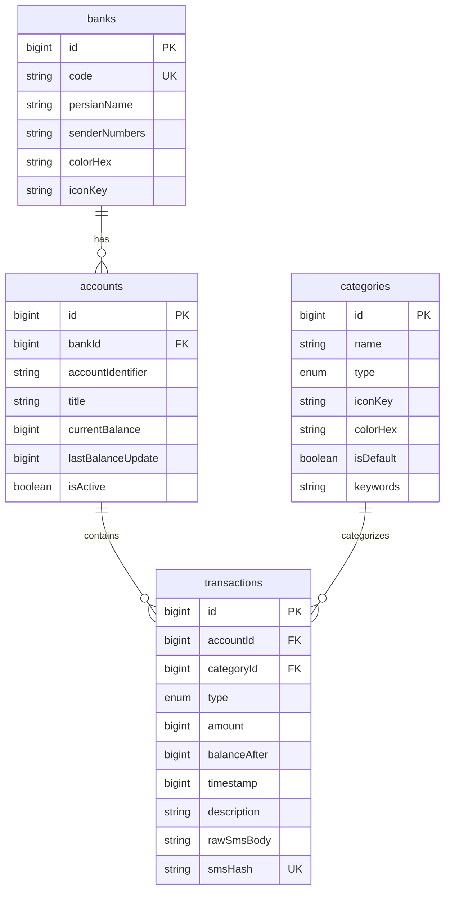
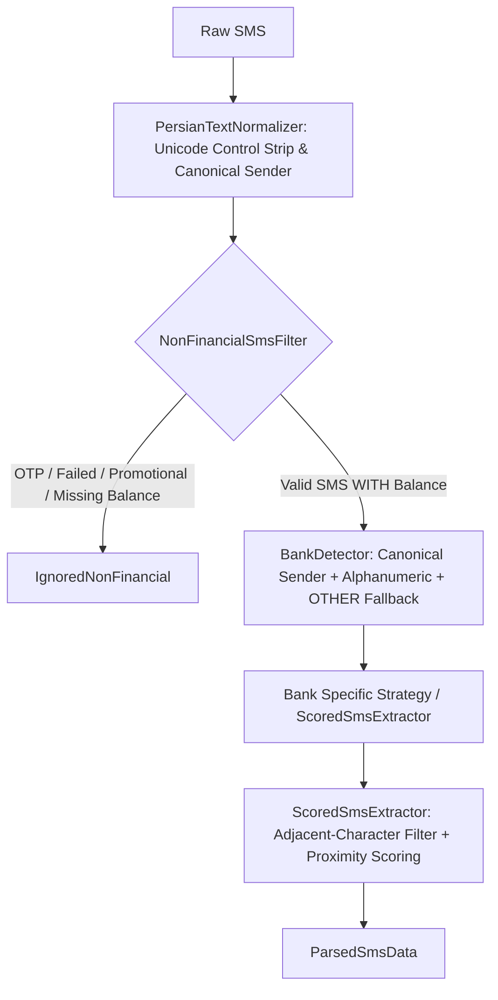
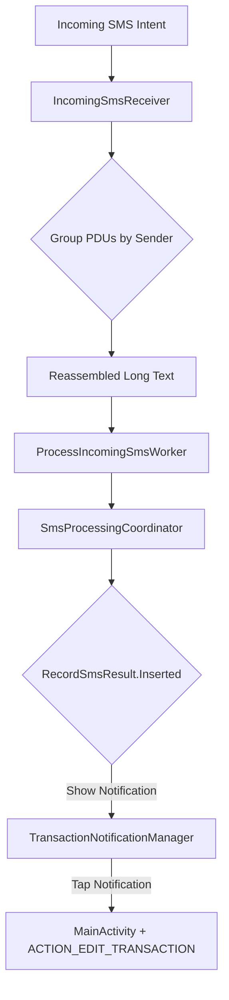
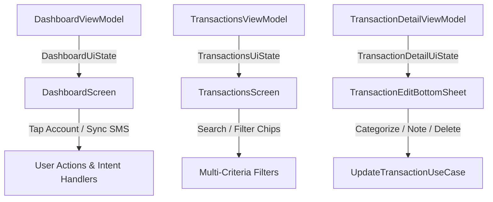
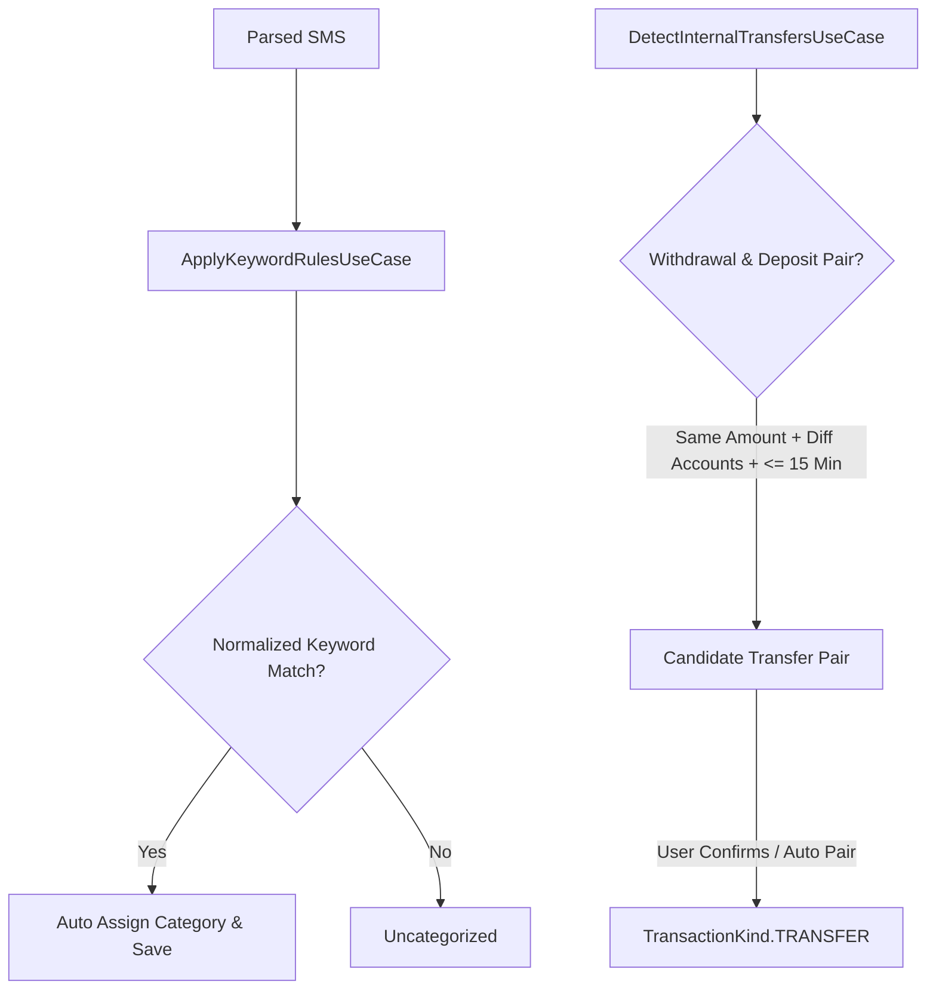
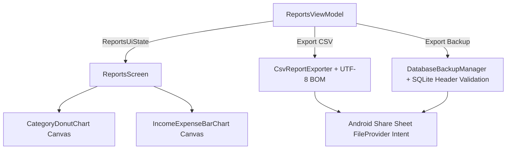

# KhodHesab (خودحساب) — Architecture Guide

KhodHesab is an offline-first, privacy-focused SMS personal accounting Android application tailored for Iranian bank transactions.

## Clean Architecture Layers

```
[ UI Layer ] (Jetpack Compose, ViewModels, Navigation)
     │
     ▼
[ Domain Layer ] (Use Cases, Domain Models, Repository Interfaces) — Pure Kotlin
     ▲
     │
[ Data Layer ] (Room Database, Repositories, DAOs) & [ SMS Engine ] (Regex Parsers, Importers)
     │
     ▼
[ Core Layer ] (Persian Normalizers, Jalali Calendar, DispatcherProvider, Security Hasher) — Pure Kotlin
```

### Layer Responsibilities
1. **Core (`ir.khodhesab.core`)**: Pure Kotlin utilities (zero Android dependencies where possible). Includes `PersianTextNormalizer`, `JalaliCalendarHelper`, `SmsHashGenerator`, and `DispatcherProvider`.
2. **Domain (`ir.khodhesab.domain`)**: Core business entities and use cases. Defines repository interfaces and business rules.
3. **Data (`ir.khodhesab.data`)**: Implementation of repositories, Room DB entities, DAOs, and data mappers.
4. **SMS Engine (`ir.khodhesab.sms_engine`)**: SMS receivers, bank-specific regex parsers, and bulk importer engines.
5. **UI (`ir.khodhesab.ui`)**: Jetpack Compose screens, Material3 theme, navigation graphs, and stateful ViewModels.

## Core Utilities Usage

### 1. Persian Text Normalizer (`PersianTextNormalizer`)
Normalizes Persian/Arabic characters, converts Persian & Arabic digits (`۰-۹`, `٠-٩`) to English digits (`0-9`), strips invisible Unicode control characters (`\u200E`, `\u200F`, `\uFEFF`), unifies separators, converts dot-separated thousands (`1.500.000` -> `1,500,000`), canonicalizes senders (`canonicalSender`), and extracts clean `Long` financial amounts.

```kotlin
val normalizedText = PersianTextNormalizer.normalize("بانك ملي\r\nمبلغ: ۱.۵۰۰.۰۰۰ ريال")
val canonicalSender = PersianTextNormalizer.canonicalSender("+98 2000 1234") // "20001234"
```

### 2. Jalali Calendar Helper (`JalaliCalendarHelper`)
Handles bidirectional Gregorian <-> Jalali date conversion, leap year detection, date formatting, and financial period boundaries (day, Iranian week Saturday–Friday, and Jalali month).

```kotlin
val jalaliDate = JalaliCalendarHelper.gregorianToJalali(2024, 3, 20) // JalaliDate(1403, 1, 1)
val (monthStart, monthEnd) = JalaliCalendarHelper.getMonthRange(System.currentTimeMillis())
val formatted = JalaliCalendarHelper.formatText(jalaliDate) // "۱ فروردین ۱۴۰۳"
```

### 3. SMS Hash Generator (`SmsHashGenerator`)
Produces deterministic SHA-256 hashes to prevent duplicate SMS imports into the local database.

```kotlin
val hash = SmsHashGenerator.generateHash(sender = "BANK-MELLI", normalizedBody = body, timestampBucket = timestamp)
```

## Database Schema & Entity-Relationship Diagram (ERD)



### Database Features
- **Composite Unique Index:** `(bankId, accountIdentifier)` on `accounts` table ensures unique user accounts under each bank.
- **SMS Deduplication:** Unique SHA-256 hash index `smsHash` on `transactions` table ignores duplicate SMS message imports.
- **Balance Concurrency Control:** `updateBalanceIfNewer` query ensures older out-of-order SMS imports do not overwrite a newer known balance.
- **Pre-seeded Initial Data:** 18 major Iranian banks (Melli, Mellat, Blu, etc.) + fallback "OTHER" bank and 16 default categories populated on database creation via `DatabaseSeeder`.

## Domain Layer Architecture & Business UseCases

The domain layer is 100% pure Kotlin (`ir.khodhesab.domain`), completely decoupled from Android frameworks and Room database annotations.

### Core Domain UseCases
1. **`RecordSmsTransactionUseCase`**: Processes incoming parsed SMS data, enforces duplicate SHA-256 hash checks (`RecordSmsResult.DuplicateSkipped`), resolves/auto-creates user bank accounts (`AccountRepository.getOrCreateAccount`), performs keyword-based auto-categorization (`CategoryRepository.matchCategoryByKeywords`), and updates account balance if reported.
2. **`AddManualTransactionUseCase`**: Validates manual transaction entries (`amount > 0`) and persists non-SMS cash records.
3. **`GetDashboardOverviewUseCase`**: Combines total active balance, active accounts list, current Jalali month financial summary, and recent 10 transactions into a single reactive `Flow<DashboardOverview>`.
4. **`GetFinancialReportUseCase`**: Computes Jalali period-based reports (`DAILY`, `WEEKLY`, `MONTHLY`) returning `FinancialSummary`, category expense/income breakdowns, and filtered transactions.
5. **`ManageAccountUseCase`**, **`ManageCategoryUseCase`**, **`UpdateTransactionUseCase`**: Handle account renaming, active toggles, custom category creation/deletion, and marking internal transfer transactions (`TransactionKind.TRANSFER`).

### Business Rules & Invariants
- **Transfer Exclusion:** Transactions classified as `TransactionKind.TRANSFER` are excluded from income/expense financial reporting calculations to prevent double-counting internal funds transfers.
- **Percentage Distribution:** Category breakdown percentages are calculated safely (`totalPeriodAmount > 0`) to prevent division-by-zero runtime exceptions.

## Resilient Context-Window Token Scoring SMS Engine (ForApp Port)



### Context-Window Scoring Rules
1. **Mandatory Balance Indicator Rule:** `NonFinancialSmsFilter` strictly requires the presence of a balance indicator keyword (`مانده`, `موجودی`, `باقیمانده`) after Persian text normalization. Messages lacking a balance keyword, or matching promotional/telecom spam patterns (`لغو 11`, `کد تخفیف`, `قرعه کشی`, `بسته اینترنت`, `مشترک گرامی`), are immediately rejected to eliminate non-bank false positives.
2. **Candidate Filtering:** Matches numeric patterns `\d{1,3}(?:,\d{3})+|\d{4,}` and excludes dates (`/`), times (`:`), masked cards (`*`), hyphenated accounts (`-`), and Sheba IDs (`len > 12`).
3. **Context Scoring:** Evaluates 25 characters preceding and 12 characters trailing each number:
   - Balance keywords (`مانده`, `موجودی`) -> `score -= 10` (saved as balance candidate).
   - Account keywords without amount context -> `score -= 4`.
   - Amount / action keywords (`مبلغ`, `واریز`, `برداشت`, `خرید`, `پرداخت`) -> `score += 4` to `+5`.
   - Adjacent `+` / `-` sign -> `score += 3` to `+4`.
   - Toman unit (`تومان`) -> `score += 2` (multiplies amount by 10 for Rials).
4. **Fallback Bank (`"OTHER"`):** Ensures no valid bank SMS with a balance indicator from unknown senders is discarded while remaining protected against false positive non-bank messages.

## Android Background SMS Processing & Sync Pipeline



### Historical Inbox Import (`OldSmsImporter`)
- **Chronological Sorting (`DATE ASC`):** Inbox messages are scanned in ascending chronological order (`DATE ASC`). This guarantees that account balances and transaction histories are calculated in true chronological sequence, ensuring `lastBalanceUpdate` reflects the latest transaction state accurately.
- **Progress Flow:** Emits `SmsImportProgress` containing progress fractions and detailed counts (`recordedCount`, `duplicateCount`, `ignoredOrUnrecognizedCount`).

## UI Layer Architecture, RTL Theme & Reusable Components

```
[ MainActivity ]
       │
       ▼
[ KhodHesabTheme ] ── (CompositionLocalProvider: LocalLayoutDirection -> LayoutDirection.Rtl)
       │
       ▼
[ MainAppScaffold ] ── (NavigationBar: Dashboard, Transactions, Reports, Categories)
       │
       ▼
[ KhodHesabNavHost ]
```

### Design System Highlights
- **Enforced RTL Layout:** Entire UI composition is wrapped inside `CompositionLocalProvider(LocalLayoutDirection provides LayoutDirection.Rtl)`.
- **Persian Currency Formatting (`PersianCurrencyFormatter`):** Converts raw database Rials into Persian-digit formatted strings (`۰-۹`) and handles user preferred display unit (`CurrencyUnit.TOMAN` or `CurrencyUnit.RIAL`) via DataStore (`AppPreferencesRepository`).
- **Reusable Core Components:**
  - `BankAccountCard`: Account card with bank accent stripe, custom title, and formatted balance.
  - `TransactionListItem`: Transaction item with category colored badge, Jalali date, bank info, and signed color-coded amount.
  - `FinancialSummaryRow`: Stat cards for Total Income (واریز), Total Expense (برداشت), and Net Balance.
  - `EmptyStateView`: Illustration, message, and action callout.
  - `CurrencyToggleChip`: Interactive pill switch for Toman/Rial toggle.

## Core Screens & MVI/MVVM StateFlow Architecture



### Screen Responsibilities & Flow
1. **`DashboardScreen`**:
   - Accounts Carousel (`BankAccountCard`) with `"همه حساب‌ها"` (All Accounts) selection and long-press account renaming.
   - SMS Sync Banner: Prompts historical SMS scanning or renders a progress bar during import.
   - Monthly Cash Flow Summary: Renders `FinancialSummaryRow`.
   - Recent Transactions list & FAB (`+`) for adding manual transactions.
2. **`TransactionsScreen`**:
   - Search bar (`OutlinedTextField`) matching transaction note or raw bank SMS text.
   - Filter Chips: Quick filter `"دسته‌بندی نشده"` (Uncategorized), transaction kinds (`DEPOSIT`, `WITHDRAWAL`, `TRANSFER`), and individual account chips.
3. **`TransactionEditBottomSheet`**:
   - Modal BottomSheet accessible globally from any screen or notification deep-link intent (`ACTION_EDIT_TRANSACTION`).
   - One-tap category grid selection, transaction kind switcher, user description notes, and raw bank SMS body viewer.

## Category Management, Keyword Auto-Categorization & Transfer Pairing



### Key Business Rules & Utilities
1. **`ApplyKeywordRulesUseCase`**:
   - Retroactively matches Persian keywords against transaction notes and raw SMS bodies.
   - Normalizes characters and Persian/English digits (`PersianTextNormalizer`) to ensure robust substring matching.
2. **`DetectInternalTransfersUseCase`**:
   - Scans non-transfer transactions to detect candidate internal card-to-card transfers between different user accounts (`account.id != other.account.id`) with matching amounts within a 15-minute window.
   - Once confirmed, both transactions are converted to `TransactionKind.TRANSFER`, keeping income/expense totals clean.

## Financial Analytics, Canvas Charts, CSV Export & SQLite Backup



### Analytics & Export Features
1. **`GetTrendSeriesUseCase`**:
   - Calculates time-series buckets for `DAILY` (7 days of Jalali week), `WEEKLY` (last 4 Jalali weeks), and `MONTHLY` (last 6 Jalali months).
   - Excludes internal transfers so trend bars reflect true income vs. expense cash flow.
2. **`CsvReportExporter`**:
   - Encodes exported CSV files with **UTF-8 BOM (`\uFEFF`)** so Microsoft Excel displays Persian text without garbled characters.
3. **`DatabaseBackupManager`**:
   - Checkpoints WAL (`PRAGMA wal_checkpoint(FULL)`), exports full `.db` files, validates SQLite header magic bytes (`"SQLite format 3\u0000"`), and restores database state safely.

## Testing & Commit Standards
- **Testing:** 100% unit test coverage required for core logic and domain use cases. Run `./gradlew testDebugUnitTest`.
- **Commits:** Conventional Commits standard (`feat:`, `chore:`, `test:`, `docs:`).
