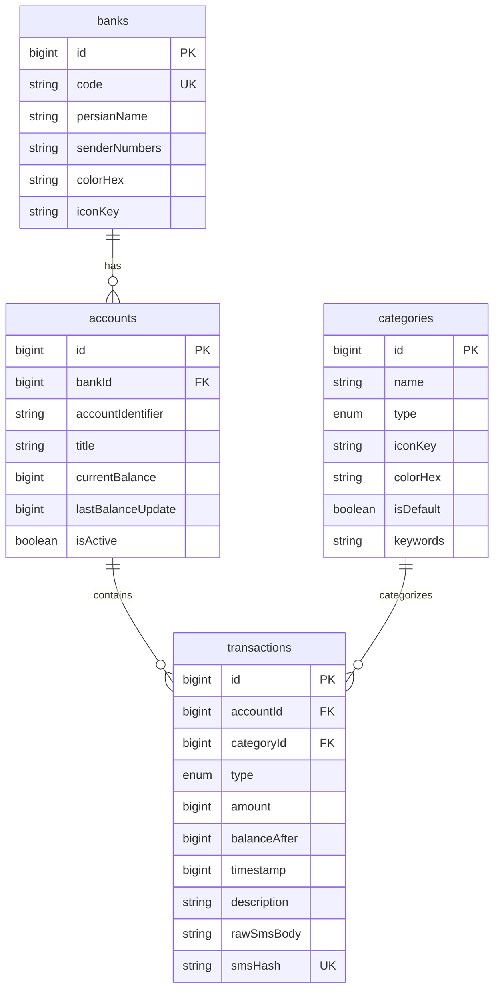

# KhodHesab (خودحساب) — Architecture Guide

KhodHesab is an offline-first, privacy-focused SMS personal accounting Android application tailored for Iranian bank transactions.

## Clean Architecture Layers

```
[ UI Layer ] (Jetpack Compose, ViewModels, Navigation)
     │
     ▼
[ Domain Layer ] (Use Cases, Domain Models, Repository Interfaces) — Pure Kotlin
     ▲
     │
[ Data Layer ] (Room Database, Repositories, DAOs) & [ SMS Engine ] (Regex Parsers, Importers)
     │
     ▼
[ Core Layer ] (Persian Normalizers, Jalali Calendar, DispatcherProvider, Security Hasher) — Pure Kotlin
```

### Layer Responsibilities
1. **Core (`ir.khodhesab.core`)**: Pure Kotlin utilities (zero Android dependencies where possible). Includes `PersianTextNormalizer`, `JalaliCalendarHelper`, `SmsHashGenerator`, and `DispatcherProvider`.
2. **Domain (`ir.khodhesab.domain`)**: Core business entities and use cases. Defines repository interfaces and business rules.
3. **Data (`ir.khodhesab.data`)**: Implementation of repositories, Room DB entities, DAOs, and data mappers.
4. **SMS Engine (`ir.khodhesab.sms_engine`)**: SMS receivers, bank-specific regex parsers, and bulk importer engines.
5. **UI (`ir.khodhesab.ui`)**: Jetpack Compose screens, Material3 theme, navigation graphs, and stateful ViewModels.

## Core Utilities Usage

### 1. Persian Text Normalizer (`PersianTextNormalizer`)
Normalizes Persian/Arabic characters, converts Persian & Arabic digits (`۰-۹`, `٠-٩`) to English digits (`0-9`), cleans thousand separators (`1,250,000`), and extracts clean `Long` financial amounts.

```kotlin
val normalizedText = PersianTextNormalizer.normalize("بانك ملي\r\nمبلغ: ۱,۲۵۰,۰۰۰ ريال")
val amount = PersianTextNormalizer.extractAmount("۱,۲۵۰,۰۰۰ ریال") // 1250000L
```

### 2. Jalali Calendar Helper (`JalaliCalendarHelper`)
Handles bidirectional Gregorian <-> Jalali date conversion, leap year detection, date formatting, and financial period boundaries (day, Iranian week Saturday–Friday, and Jalali month).

```kotlin
val jalaliDate = JalaliCalendarHelper.gregorianToJalali(2024, 3, 20) // JalaliDate(1403, 1, 1)
val (monthStart, monthEnd) = JalaliCalendarHelper.getMonthRange(System.currentTimeMillis())
val formatted = JalaliCalendarHelper.formatText(jalaliDate) // "۱ فروردین ۱۴۰۳"
```

### 3. SMS Hash Generator (`SmsHashGenerator`)
Produces deterministic SHA-256 hashes to prevent duplicate SMS imports into the local database.

```kotlin
val hash = SmsHashGenerator.generateHash(sender = "BANK-MELLI", normalizedBody = body, timestampBucket = timestamp)
```

## Database Schema & Entity-Relationship Diagram (ERD)



### Database Features
- **Composite Unique Index:** `(bankId, accountIdentifier)` on `accounts` table ensures unique user accounts under each bank.
- **SMS Deduplication:** Unique SHA-256 hash index `smsHash` on `transactions` table ignores duplicate SMS message imports.
- **Balance Concurrency Control:** `updateBalanceIfNewer` query ensures older out-of-order SMS imports do not overwrite a newer known balance.
- **Pre-seeded Initial Data:** 18 major Iranian banks (Melli, Mellat, Blu, etc.) and 16 default categories populated on database creation via `DatabaseSeeder`.

## Domain Layer Architecture & Business UseCases

The domain layer is 100% pure Kotlin (`ir.khodhesab.domain`), completely decoupled from Android frameworks and Room database annotations.

### Core Domain UseCases
1. **`RecordSmsTransactionUseCase`**: Processes incoming parsed SMS data, enforces duplicate SHA-256 hash checks (`RecordSmsResult.DuplicateSkipped`), resolves/auto-creates user bank accounts (`AccountRepository.getOrCreateAccount`), performs keyword-based auto-categorization (`CategoryRepository.matchCategoryByKeywords`), and updates account balance if reported.
2. **`AddManualTransactionUseCase`**: Validates manual transaction entries (`amount > 0`) and persists non-SMS cash records.
3. **`GetDashboardOverviewUseCase`**: Combines total active balance, active accounts list, current Jalali month financial summary, and recent 10 transactions into a single reactive `Flow<DashboardOverview>`.
4. **`GetFinancialReportUseCase`**: Computes Jalali period-based reports (`DAILY`, `WEEKLY`, `MONTHLY`) returning `FinancialSummary`, category expense/income breakdowns, and filtered transactions.
5. **`ManageAccountUseCase`**, **`ManageCategoryUseCase`**, **`UpdateTransactionUseCase`**: Handle account renaming, active toggles, custom category creation/deletion, and marking internal transfer transactions (`TransactionKind.TRANSFER`).

### Business Rules & Invariants
- **Transfer Exclusion:** Transactions classified as `TransactionKind.TRANSFER` are excluded from income/expense financial reporting calculations to prevent double-counting internal funds transfers.
- **Percentage Distribution:** Category breakdown percentages are calculated safely (`totalPeriodAmount > 0`) to prevent division-by-zero runtime exceptions.

## Testing & Commit Standards
- **Testing:** 100% unit test coverage required for core logic and domain use cases. Run `./gradlew testDebugUnitTest`.
- **Commits:** Conventional Commits standard (`feat:`, `chore:`, `test:`, `docs:`).
